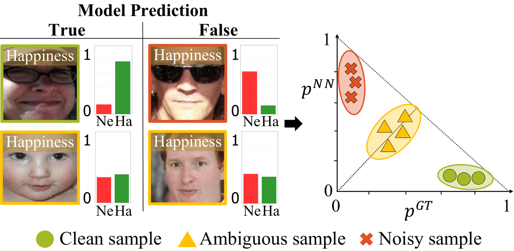
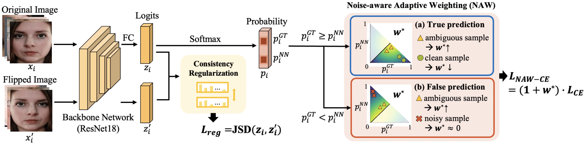
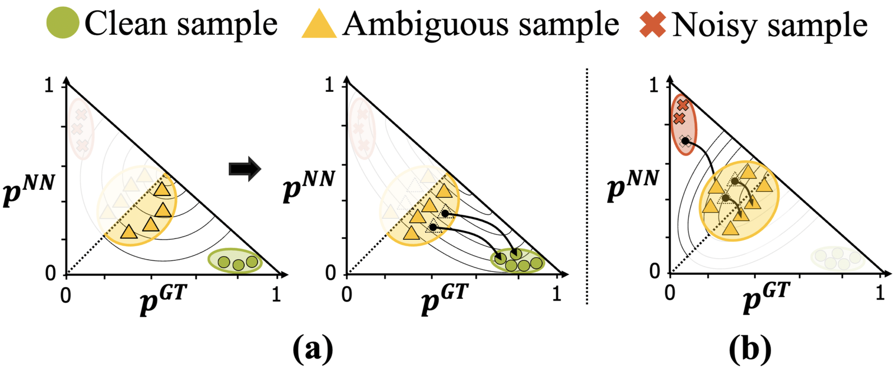
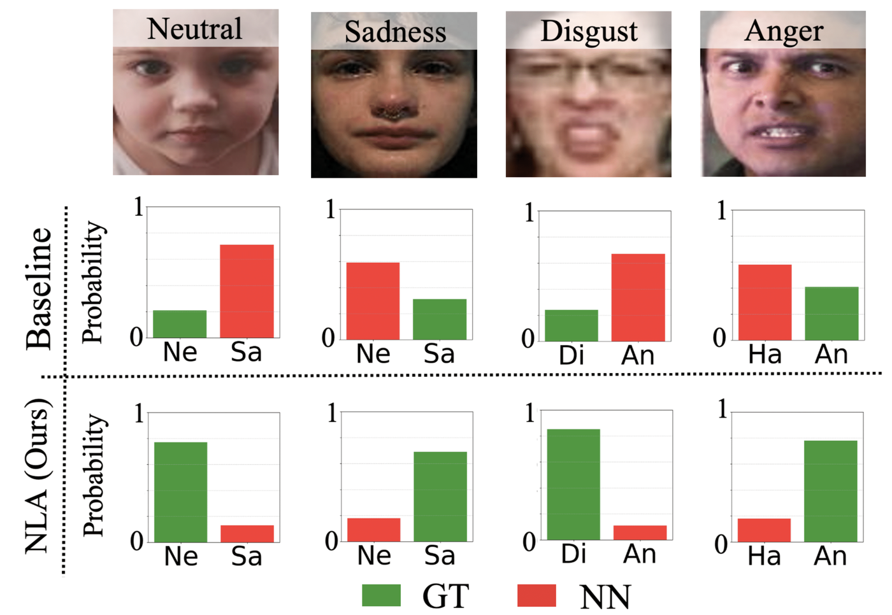

<h2 align="center">Navigating Label Ambiguity for<br>Facial Expression Recognition in the Wild</h2>
<p align="center">
  <a href="https://jungyu0413.github.io/"><strong>JunGyu Lee</strong></a><sup>*</sup>
  ·
  <strong>Yeji Choi</strong><sup>*</sup>
  ·
  <a href="https://scholar.google.com/citations?user=F5z0unQAAAAJ"><strong>Haksub Kim</strong></a>
  ·
  <a href="https://sites.google.com/view/ijkim"><strong>Ig-Jae Kim</strong></a>
  ·
  <a href="https://vig.kist.re.kr"><strong>Gi Pyo Nam</strong></a>
  <br>
  AAAI 2025
  <br>
  <sub><sup>*</sup>Equal contribution</sub>
</p>

<p align="center">
  <a href="https://jungyu0413.github.io/NLA/"><strong><code>Project Page</code></strong></a>
  <a href="https://ojs.aaai.org/index.php/AAAI/article/view/32476"><strong><code>AAAI Paper</code></strong></a>
  <a href="https://arxiv.org/abs/2502.09993"><strong><code>arXiv</code></strong></a>
  <a href="https://drive.google.com/file/d/12NY75DwMUnXFbRYDQso4eXIxLAV2PP63/view?usp=drive_link"><strong><code>Pretrained Weights</code></strong></a>
  <a href="https://github.com/jungyu0413/V-NAW"><strong><code>Video Extension (V-NAW)</code></strong></a>
  <a href="#-citation"><strong><code>Citation</code></strong></a>
</p>

<div align="center">
  <br>
  <br>NLA estimates how ambiguous each sample is from the prediction scores of the ground truth (GT) and its nearest negative (NN).
</div>

<br>**Summary**: A single-backbone training framework that handles **label noise** and **class imbalance** in facial expression recognition at the same time, by re-weighting every sample according to its **estimated ambiguity**.

<br>

## 🧭 NLA Framework
* **Ambiguity from two scores**: The relation between the GT score and the nearest-negative score separates clean, ambiguous, and noisy samples, without extra networks or clean subsets.
* **Noise-aware Adaptive Weighting (NAW)**: A multivariate Gaussian kernel over (p<sup>GT</sup>, p<sup>NN</sup>) gives ambiguous samples the highest weight and suppresses noisy ones, with separate kernels for true and false predictions.
* **Covariance scheduler**: The kernel shape changes over training, so the model first learns the majority classes and then shifts attention to ambiguous samples, which mostly belong to minority classes.
* **Consistency regularization**: Jensen-Shannon divergence aligns the predictions of an image and its horizontally flipped copy, keeping the per-sample weights reliable.
* **Strong minority-class accuracy**: On RAF-DB, NLA is the first to reach 70% accuracy on both Disgust and Fear, and it also leads under synthetic label noise and class imbalance.

<div align="center">
  <br>
  <br>Overview of NLA: NAW re-weights the cross-entropy loss per sample, and consistency regularization aligns original and flipped views.
</div>

<div align="center">
  <br>
  <br>How NAW moves samples during training: (a) when the prediction is true, (b) when the prediction is false.
</div>

<br>

## 📊 Results
All methods use a ResNet-18 backbone pre-trained on MS-Celeb-1M. Numbers are taken from the paper.

**RAF-DB** (accuracy, %)

| Method | Venue | Overall | Mean | Disgust | Anger | Fear |
| :-- | :-: | :-: | :-: | :-: | :-: | :-: |
| Baseline | – | 87.42 | 78.53 | 58.75 | 78.40 | 59.46 |
| RUL | NeurIPS'21 | 88.66 | 81.66 | 65.00 | 83.33 | 64.86 |
| EAC | ECCV'22 | 89.05 | 81.09 | 61.25 | 83.33 | 60.81 |
| MEK | NeurIPS'23 | 89.77 | 82.44 | 66.89 | 80.86 | 66.22 |
| **NLA (Ours)** | AAAI'25 | **89.93** | **83.87** | **70.00** | **84.57** | **70.27** |

**AffectNet** (7 classes, class-balanced test set, overall accuracy %): RUL 61.56 · EAC 65.17 · MEK 65.73 · **NLA 67.06**

<details>
<summary><b>Robustness to label noise and class imbalance</b> (click to expand)</summary>

<br>Overall accuracy (%) with 10 / 20 / 30% of training labels randomly flipped. NLA is the mean over five seeds.

| Method | RAF-DB 10% | RAF-DB 20% | RAF-DB 30% | AffectNet 10% | AffectNet 20% | AffectNet 30% | FERPlus 10% | FERPlus 20% | FERPlus 30% |
| :-- | :-: | :-: | :-: | :-: | :-: | :-: | :-: | :-: | :-: |
| Baseline | 81.01 | 77.98 | 75.50 | 57.24 | 55.89 | 52.16 | 83.29 | 82.34 | 79.77 |
| SCN | 82.18 | 80.10 | 77.46 | 58.58 | 57.25 | 55.05 | 84.28 | 83.17 | 82.47 |
| RUL | 86.17 | 84.32 | 82.06 | 60.54 | 59.01 | 56.93 | 86.93 | 85.05 | 83.90 |
| EAC | 88.02 | 86.05 | 84.42 | 61.11 | 60.29 | 58.91 | 87.03 | 86.07 | 85.44 |
| LA-Net | 88.75 | 87.12 | 85.33 | 62.85 | 61.72 | 60.82 | 88.02 | 86.85 | 86.01 |
| **NLA (Ours)** | **88.83** | **87.60** | **86.71** | **63.52** | **63.25** | **62.48** | **88.20** | **87.64** | **86.97** |

<br>Overall / mean accuracy (%) on RAF-DB with imbalance factors of 50, 100, and 150. NLA is the mean over five seeds.

| Method | IF 50 | IF 100 | IF 150 |
| :-- | :-: | :-: | :-: |
| Baseline | 83.28 / 64.69 | 80.96 / 55.12 | 80.11 / 56.53 |
| BBN | 85.01 / 71.57 | 83.44 / 67.92 | 82.92 / 65.49 |
| EAC | 87.09 / 73.02 | 85.79 / 69.80 | 84.13 / 68.66 |
| MEK | 87.65 / 77.11 | 86.47 / 73.06 | 85.20 / 70.33 |
| **NLA (Ours)** | **87.97 / 78.05** | **87.98 / 73.34** | **86.34 / 70.49** |

</details>

<div align="center">
  <br>
  <br>Ambiguous RAF-DB samples: the baseline confuses GT and NN, while NLA predicts the GT with a large margin.
</div>

<br>

## 🚀 Getting Started
### Setup
**Environment**
<br>The code is written in Python 3.8 with PyTorch. Install the remaining dependencies with:
```bash
git clone https://github.com/jungyu0413/NLA.git
cd NLA
pip install torch torchvision numpy pandas opencv-python tqdm wandb
```
Training logs are sent to [Weights & Biases](https://wandb.ai). Run `wandb login` first, or set `WANDB_MODE=offline` to log locally.

**Pre-trained backbone**
<br>NLA starts from a ResNet-18 pre-trained on MS-Celeb-1M (`resnet18_msceleb.pth`), the same backbone used by RUL and EAC. Download it from the [RUL repository](https://github.com/zyh-uaiaaaa/Relative-Uncertainty-Learning#pretrained-backbone-model), then point the path in [`src/model.py` line 15](src/model.py#L15) to the file.

**Dataset**
<br>Download [RAF-DB](http://www.whdeng.cn/RAF/model1.html) (basic emotions) and keep the official layout:
```
raf-basic/
├── EmoLabel/list_patition_label.txt
└── Image/aligned/*_aligned.jpg
```

### Train and evaluate on RAF-DB
`main_rafdb.py` trains NLA and evaluates on the RAF-DB test split after every epoch. Set the GPU id in [`main_rafdb.py` line 3](main_rafdb.py#L3), then run:
```bash
python main_rafdb.py \
  --dataset_path raf-basic \
  --label_path raf-basic/EmoLabel/list_patition_label.txt \
  --output outputs
```
The defaults follow the paper: batch size 32, Adam with learning rate 1e-4 and weight decay 1e-4, ExponentialLR (γ = 0.9), and 60 epochs.
Two checkpoints are saved to `outputs/rafdb/NAW_NLA/`: `best.pth` (best overall accuracy) and `best_mean.pth` (best mean accuracy).

### Pretrained weights
Our trained checkpoints are available on [Google Drive](https://drive.google.com/file/d/12NY75DwMUnXFbRYDQso4eXIxLAV2PP63/view?usp=drive_link).

<br>

## 📖 Citation
If you find this work useful for your research, please cite our papers :)

[**`😐😲 NLA (AAAI'25) 😢😠`**](https://github.com/jungyu0413/NLA) **|**
[**`🎬 V-NAW (CVPRW'25) 🎬`**](https://github.com/jungyu0413/V-NAW)

```bibtex
@inproceedings{lee2025navigating,
  title={Navigating Label Ambiguity for Facial Expression Recognition in the Wild},
  author={Lee, JunGyu and Choi, Yeji and Kim, Haksub and Kim, Ig-Jae and Nam, Gi Pyo},
  booktitle={Proceedings of the AAAI Conference on Artificial Intelligence},
  volume={39},
  number={4},
  pages={4517--4525},
  year={2025},
  doi={10.1609/aaai.v39i4.32476}
}
```
<details>
  <summary>More Information (Click to expand)</summary>

```bibtex
@inproceedings{lee2025vnaw,
  title={V-NAW: Video-based Noise-aware Adaptive Weighting for Facial Expression Recognition},
  author={Lee, JunGyu and Lee, Kunyoung and Park, Haesol and Kim, Ig-Jae and Nam, Gi Pyo},
  booktitle={Proceedings of the IEEE/CVF Conference on Computer Vision and Pattern Recognition (CVPR) Workshops},
  pages={5689--5696},
  year={2025}
}
```
</details>

<br>

## 🙏 Acknowledgements
This research was supported by the Field-oriented Technology Development Project for Customs Administration through the National Research Foundation of Korea (NRF) funded by the Ministry of Science & ICT and Korea Customs Service (2022M3I1A1095154), and by the KIST Institutional Program (Project No. 2E33001).
